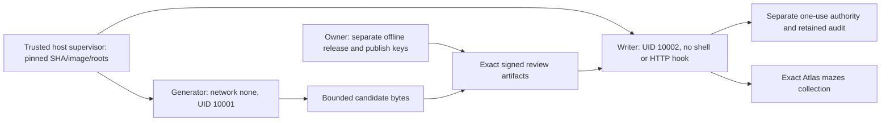

# ADR 001: a dedicated Linux host, disposable containers, external one-use authority

Status: **proposed for independent Systems/Security review, production NO-GO**.
Issue [#26](https://github.com/MZKZxyz/fort-custer-server/issues/26), parent #6.
Engineering baseline fetched and verified before edits:
`62fd6401cb10ba1cac26f4ad48e3209ae0972846` (Sprint 1.7H, PR #25).

## Decision and alternatives

For a solo-developed game with occasional manual one-date publication, recommend
one dedicated, patched Linux host running a fixed supervisor and two short-lived
containers. An existing spare Linux machine is sufficient for a **later approved**
pilot; otherwise budget a small independent VM. Keep the host outside Railway's
application/secret environment. No Kubernetes, deployment service, scheduler or
web control plane is needed. Do not use the developer's everyday shared Docker
daemon as the production trust boundary. This sprint creates only local test
containers/volumes on the supplied managed daemon.

| Option | Actual guarantees and limitations | Cost and maintenance | Operations / failure handling |
| --- | --- | --- | --- |
| Dedicated Linux host + Docker + host systemd supervisor (recommended) | Linux network/PID/mount namespaces, cgroup v2 hard memory/swap/PID limits and CPU quota; seccomp, capability drop, no-new-privs. Host root/daemon/kernel remain trusted; containers are not microVMs. Host firewall can constrain full Atlas topology. Rootless Docker alone does not establish cgroup delegation or endpoint policy. | Existing dedicated host: no incremental rental; small independent VM planning allowance $5–12/month plus backups. Owner patches host/daemon, reviews firewall changes, rotates secrets, verifies time and recovery. | Manual fixed command, no inbound port. RuntimeMaxSec on a host service plus ExecStopPost/boot sweep must kill labeled containers even if supervisor dies. Quota is not a deadline. Stop on any missing enforcement. |
| AWS ECS Fargate task pair with VPC policy | Managed task isolation, task memory/vCPU and task identity; no supported Docker-equivalent per-container pids-limit/seccomp/custom network namespace controls to simply copy this proof. Generator without an ENI route/credentials and writer with security group egress can be separated as tasks; DNS/IP topology management still required. A task stop/watchdog is separately needed; task duration has no built-in one-shot TTL. | Illustrative US East Linux x86 rates: $0.04048/vCPU-hour + $0.004445/GiB-hour; two 0.25-vCPU/0.5-GiB tasks at the 1-minute minimum are about $0.00041/run before networking/logging. Verify current region pricing. A public IPv4 at ~$0.005/hour or NAT at ~$0.045/hour + bytes can dominate compute; always-on NAT about $33/month alone. | More IAM/VPC/security-group/ECR/task/watchdog setup and full-topology egress work; managed host patching helps. Log retention and stopped-task reconciliation are still owner's responsibilities. Not selected for this manual, low-volume workflow. |

Both are available public technologies; this session inspected neither a real
production host nor an AWS account and provisioned neither. These are budget
estimates, not a quote, free-tier promise or evidence of account availability.
Reference pricing: [Fargate](https://aws.amazon.com/fargate/pricing/),
[VPC](https://aws.amazon.com/vpc/pricing/). An independently deployed Railway
service is not a substitute for verified per-job network/cgroup/secret boundaries.
GitHub-hosted Actions can run this disposable proof, but repository write access,
workflow changes and pull-request execution must never become live signing or
database authority.

## Execution and signing boundaries

The host builds an exact clean Git archive with locked dependencies and disabled
package install scripts; records source SHA, base digest, runtime image ID and a
measurement of every source/dependency file. Production requires owner-approved
build provenance and an immutable registry digest approved **after merge**, not
just a caller's source label. Verify that digest before creating a container;
verify measured content before importing generator/writer modules. A bootstrap
that an attacker can rewrite is not an independent attestation. Host/daemon root
can replace the entire image and policy and is explicitly trusted.

Release and publish Ed25519 roles remain separate; canonical parsed key identity
checks from 1.7H remain in use. Production roots and target/source policy must be
installed by the owner out of band on the trusted supervisor. They never come
from an operation request, repository-controlled workflow, environment flag or
fixture context. Offline owner signing requires review of the exact plan,
release, UTC date/window, source/image identity and target fingerprint. No private
key enters either container. The proof generates disposable keys in supervisor
memory and mounts only public policy. It neither authenticates the real owner
nor issues a release certificate. Its `isolated-fixture-*` envelopes have no
production meaning and intentionally omit the complete production release/time
protocol already tested in 1.7H. They cannot replace that protocol.

The generator receives no writer credentials, policy volume, database socket,
host mounts or daemon socket; its entire network namespace has only loopback.
Source is in the read-only image. Scratch is an 8 MiB noexec/nosuid/nodev tmpfs;
stdout is capped at 256 KiB and daemon logging is disabled. No writable shared
generator-to-writer volume exists: the supervisor transfers bounded bytes.

The fixture writer also uses `network=none`. Its sole database path is a read-only
mount containing a Unix socket of a separate disposable MongoDB. The read-only
mount prevents replacing/unlinking that socket; it does not prevent commands
through it. MongoDB authentication and exact-collection privileges constrain
commands. A distinct 0600 credential file owned by UID 10002 is mounted only in
the writer. The fixture reader has its own find-only account. No generic URI,
host environment selector, TCP port publishing, shell entrypoint, app startup
hook or HTTP endpoint is provided. This new harness never calls the existing
guarded `operateDisposable` with a broadened target policy.

Both job classes use 256 MiB hard memory, zero swap, 0.5 CPU quota, 32 total tasks
(Node threads count), 64 file descriptors, all capabilities dropped,
no-new-privs and Docker's default seccomp filter. These are **fixture budgets**,
not approved production budgets; benchmark worst allowed inputs before production.
The inherited Node 1.5s/128 MiB worker protections remain unchanged. The isolated
generator invokes the same pure engine directly, so this is a new OS containment
proof, not a retrofit of that worker's sampled RSS into a security boundary.

The proof uses a host watchdog to ask the daemon for container SIGKILL. Linux
PID-namespace teardown kills detached descendants. It checks stopped/PID-zero
state after every job. **Host-supervisor death is not covered by this timer.**
A reviewed host service RuntimeMaxSec, cleanup handler and boot sweep are required
before live use; no production service unit is installed here. Never report this
proof's external timer as an independently durable OS wall-time controller.

## Atlas boundary required later (design only)

Use a dedicated short-lived SCRAM or approved certificate identity restricted to
`find` and `insert` on the exact production `mazes` namespace. Add `listIndexes`
only on that collection. `listCollections` for UUID/options requires database
metadata visibility; separately approve that visibility or use a separate trusted
metadata inspector. No broad `readWrite`, players, update/delete/upsert, index or
schema/user/role DDL. Attest effective privileges including inherited roles, and
test denied operations with the actual identity. Permission to insert alone does
not enforce a date, document shape or certificate; the reviewed writer is trusted
to honor those constraints. Mongo roles cannot enforce per-document one-date
authority by themselves. A compromised credential remains a bounded-namespace
integrity risk; constrain lifetime, validator and auditing accordingly.

A later Atlas connection policy must enforce all of:

1. Mandatory TLS with hostname/certificate verification and approved CA roots;
   reject every tlsAllowInvalid*, tlsInsecure, arbitrary proxy/CA, SRV/options or
   URI override. Pin approved replica-set name and deployment identity. Explicit
   seed topology is simpler to audit than caller-selected SRV discovery.
2. Resolve the complete approved replica set using a trusted host resolver before
   opening credentials. Reject unexpected discovery members, loopback/link-local/
   metadata/private ranges unless explicitly approved, DNS changes outside the
   reviewed topology, and certificate-name mismatch. Cover IPv4 **and** IPv6.
3. Deny-by-default host nftables rules for a dedicated writer namespace, allowing
   only approved resolved member IPs and Atlas ports. Writer gets no DNS or
   Internet proxy; topology DNS refresh happens under the trusted supervisor.
   Bind each approved IP to TLS hostname/SNI and validate every driver-discovered
   endpoint before connection; ordinary Mongo connection-string checks alone do
   not do this. A reviewed egress gateway/driver connector may be required.
   Changing Atlas IPs means fail closed and review/refresh, never wildcard egress.
4. Include every member/monitoring connection in capacity and firewall tests.
   Single pool size does not mean one socket for a replica set. Fixture direct
   Unix socket mode validates none of these TLS/discovery properties.
5. Deliver credentials by protected descriptor or owner-controlled read-only
   credential mount, never CLI arguments, generic .env, shell history, logs or
   inherited Railway secrets. Host-only fixture admin material is not mounted
   in a job. Remove credential mounts after stop and rotate after uncertainty.

Verify collection UUID, validator/options and ordered index fingerprints before
claim and immediately before insert, using UUID-bound commands. Require the
unique date index. Administrative DDL must be fenced for the entire window by a
separate owner-controlled procedure/authority; writer's lack of DDL permission
does not prevent a concurrent administrator from changing indexes/validator.
Fingerprint checks leave a TOCTOU interval. An unfenced target remains NO-GO.

## Global authority, audit, uncertainty

The fixture uses one central authenticated MongoDB replica set and a single
majority insert: an immutable intent document has the approval ID as `_id` and a
unique compound index on logical namespace/date. Both uniqueness constraints and
the embedded audit intent commit atomically. No session transaction API (which
can retry commits internally), callback or insert retry is used. Claims have no
TTL and the job role cannot update/delete them. Unknown claim
ACK burns the attempt and authorizes **zero** maze writes, even if a later
read finds its claim. After an acknowledged claim, submit at most one UUID-bound
maze insert, then primary-majority exact-date read. Unknown ACK never causes a
second submit. A separate find-only account reconciles exact signed content and
original intent. Missing/failed reads remain uncertain. No reset/supersede path.
Maze insertion and claims are intentionally separate one-shot commands.

This demonstrates central concurrency and local-directory rollback resistance
(jobs have no local ledger), **not** multi-node failover, malicious DBA resistance,
durable audit retention after volume destruction or database-restore resistance.
The single-member fixture's majority is one disk. Explicit local ACK fault
injection models lost responses; it is not proof of a particular network partition.
Existing 1.7H tests separately inject actual MongoDB connection/concern failures.

For later production, prefer a tiny managed authority using DynamoDB on-demand
`TransactWriteItems` with three conditionally absent records: global approval ID,
canonical deployment/namespace/date (not collection UUID, so namespace recreation
cannot free the date), and immutable intent. A small separate broker validates
the owner signatures/source/target/window and is the only allowed issuer. Writer
gets invocation authority only, no table mutation credentials. The broker returns
an exact attempt receipt only after acknowledged conditional commit. Disable SDK
retries and transaction-token replay as authorization recovery. A lost response
still stops publication; eventual read-only investigation cannot mint a fresh GO.
No leases that expire back into availability, TTL, automatic retry or claim reset.

Pin table account/region/ARN and require strongly consistent recovery reads. Deny
update/delete/TTL/restore/table-alias changes to runtime identities. Restores make
a different table ARN and must fail the pin; owner recovery must compare retained
spent records to the external audit before accepting any new authority. Append
intent/result receipts to separately administered S3 Object Lock compliance
retention with a creation-only producer, independently checked retention and
alerts; fail before the DB submit if required intent retention cannot be proven.
Root/account administrators remain in the trust model: no design can resist an
administrator replacing both roots and all external evidence. Separate ownership
and immutable retention must resist **local** rollback and supported restore paths.
No AWS resources, roles, keys, brokers or buckets were created this sprint.

An acknowledged claim followed by any timeout, OOM, host failure, target drift or
audit failure stays spent. Recovery uses a separate approved find-only identity,
exact date/UUID/content and original receipt. Conflicting content is an incident;
absent winner is uncertainty, never permission to reroll, insert again, delete or
choose a new day. Retain alerts for claim uncertainty, denied access, deadline,
quota failure, target drift, missing winner, collision and audit unavailability.
If the target is unreadable, stop and preserve authority/evidence.

## Operating cost and obligations

At 1–31 manual publications/month, host rental and operator attention dominate:

| Item | Planning estimate / obligation |
| --- | --- |
| Dedicated host | $0 incremental on an existing dedicated machine, or ~$5–12/month VM; allow ~$1–3/month for backups/logs. Electricity/provider egress separate. Patch monthly and urgently for kernel/container issues. |
| Global authority and immutable audit | DynamoDB on-demand + a small broker + a few KB immutable receipts: typically cents/month at this volume, budget $1/month excluding minimums, alarms, KMS and long retention. Validate current region pricing and actual IAM/Object Lock behavior before approval. Avoid NAT/always-on gateway for these tiny calls. |
| Atlas | Reuse the later owner-approved deployment; incremental scoped identity is not a new cluster. Private endpoints/dedicated cluster upgrades can dominate and are **not** included or authorized. Do not assume an existing free tier meets required network/DDL controls. |
| Recovery | Back up trusted policy and receipts; exercise read-only recovery. Never restore spent authority backwards. Keep a tested fresh-compatible server image; publication rollback never deletes grids. |
| Human work | Initial host/firewall/authority hardening and independent QA; then patching, topology drift review, key rotation, audit/backup checks and manual approvals. A VM is cheap only if the owner accepts these duties. |

References: [DynamoDB](https://aws.amazon.com/dynamodb/pricing/on-demand/),
[Lambda](https://aws.amazon.com/lambda/pricing/),
[S3](https://aws.amazon.com/s3/pricing/). Rates are illustrative estimates; no
pricing endpoint, account entitlement or production infrastructure was queried.

Production acceptance and demonstrated gaps are in [the threat model](THREAT-MODEL.md)
and [reproduction/QA instructions](ISOLATION-PROOF.md). This ADR is an engineering
recommendation, not independent QA acceptance or authorization to provision it.
