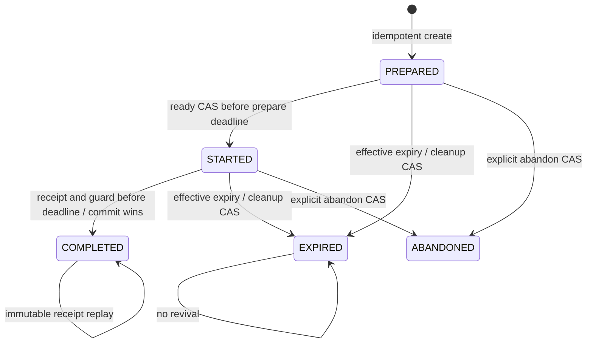

# FC-SYS-01 — playable sessions and permanent per-maze bests

RFC **v0.3**, continued from `e30e1b72f51f19f7e20f646770bc08dcfed67551` on `design/fc-sys-01-rfc`. **Design proposal; no implementation, migration or activation approval.** Only this RFC directory changes. Lead: Server Systems Architect / Integrator; reviewers: Gameplay/Security, Independent QA; Progression owns the SYS-03 interface.

Acceptance authority: [consolidated handoff 6416107046](https://github.com/MZKZxyz/fort-custer-server/issues/5#issuecomment-6416107046), [Independent QA delta](https://github.com/MZKZxyz/fort-custer-server/issues/5#issuecomment-6416076593), [Gameplay/Security delta](https://github.com/MZKZxyz/fort-custer-server/issues/5#issuecomment-6415910687), and the later [owner clarification 6416037589](https://github.com/MZKZxyz/fort-custer-server/issues/5#issuecomment-6416037589). The owner clarification supersedes the earlier high-assurance interpretation of D1=B. Previous reviews were conditional design promotion, not runtime or release approval.

Fort Custer prioritizes maze exploration, collectibles, narrative/Field Journal and personal satisfaction. Leaderboards are optional, low-stakes recognition inspired by the physical contests. Placement, participation or fast times must not gate collection completion, core progression, unique competitive advantages or scarce valuable rewards. Any commemorative weekly/personal-best recognition needs Owner/UX policy, separate from OD-09 date entitlement. Reasonable route/timing validation is required; live anti-cheat infrastructure is not the initial release gate.

Read with the [transcript/replayer specification and architecture comparison](transcript.md), [decision matrix](decisions.md), [smallest implementation package and isolated transaction tests](implementation-plan.md), and [reproducible validation record](validation.md). Approved OD-05/08/09/12/15 and EG-09 equal logical visibility stay intact. D2/D5/D6, material cutover/TTL/privacy tradeoffs and actual implementation evidence remain gates; routine engineering defaults need no repeated owner vote. Client UX #45 stays independent.

## Consolidated delta checklist

| Requirement | v0.3 disposition | Executable evidence |
| --- | --- | --- |
| QA P2 clock reversal | Pre-commit CLOCK_UNAVAILABLE vs diagnostic post-commit observation; durable result/unknown-outcome precedence; fenced abort resolution | Guard and observation offsets −1/0/+1; unknown committed and unknown uncommitted outcomes; old request fenced after abort |
| QA P2 key scope | Account/operation/key for create/complete; account/attempt/operation/key for ready/abandon, with payload hashes | Same ready/abandon key on two owned attempts; changed nonce/reason conflict within one attempt; foreign replay denied |
| D1 target | Server-owned timing + deterministic legal route replay, no per-step round trip; fabricated legal routes remain possible | Missing/partial route cannot create receipt; valid fabricated route has limited tier; hash-bound idempotency |
| Replay semantics | Pinned S/E/grid; boundaries/walls, equipment, stationary fire clearing and terminal tipi arrival | Separate standalone validator suite, canonical source-fixture comparison, malformed/order/size boundaries |
| Product/privacy/labels | Exact latency disclosure; confidential cursor; public allowlist; manifest binds tier, validator and label | Binding tested offline; HTTP serialization/cursor/consent remain implementation tests |
| Implementation boundary | One substantive server/client/compatibility work package following isolated replica-set feasibility | Explicit transaction/restart/failpoint matrix; no DB tests executed by this design package |

## Audit and pinned baseline

Carried forward from the v0.1 pinned source audit, not a live-system audit. This reconciliation re-read server start/completion source; it does not claim a new client audit:

| Repository / main SHA | Evidence | Observed behavior |
| --- | --- | --- |
| server `d82c272b47486161bf9f37508b69fe3240678655` | `routes/mazeRoutes.js` start/complete | Authenticated user/profile ownership, date validation; every start appends a UUID attempt before sending grid. No ready endpoint or create deduplication; start conflicts return409. No publication-date check beyond maze existence. |
| same | `services/completions.js` | Server receipt minus stored start, rounded seconds, blanket3-second floor. No path or goal proof. UUID-scoped immutable result replay; missing-ID legacy latest selector pinned only within one request. Eight OCC retries on User save. Optional expiry, no expiry assigned by start. |
| same | `models/User.js`, `docs/completion-reliability.md` | Embedded unbounded attempt arrays, mixed immutable result snapshots, User optimistic concurrency. Invalid/missing __v blocks writes. One User write atomically commits completion, reward, progress; replacing it with several collections loses atomicity unless explicitly restored. |
| same | `routes/leaderboardRoutes.js` | Public daily/weekly/alltime queries scan every User; latest progress time, not historical minimum. Summer2025 daily restriction; weekly sums and different completion counts are not equal-comparison race boards. Names/profile IDs currently exposed; v2 public identity/privacy needs review. |
| same | `routes/userRoutes.js` progress | Direct fabricated progress completion already rejected; completed progress can be read. |
| same | completion service reward branch | A distinct attempt can award another unowned item for the same date. Duplicate UUID protection is not date-level first-completion eligibility. OD-09 requires separate EG-03 resolution. Never infer live duplicated awards or alter old inventory. |
| client main `8664c4f2026e8ec4857b31f40e51e5a7e1ce3b97` | `src/pages/MazePage.js` loading/finish | Display uses performance.now after response state initialization, not a server ready ACK or confirmed art/layout readiness. Local storage Date.now is not server scoring input. Finish locks input, saves UUID in sessionStorage, posts profile/date/UUID with15s timeout, retries same intent. |
| same | `src/game/{inputController,inputCoordinator,movement}.js` | Single scheduler, canonical client transition;400ms first hold repeat/180ms repeat; manual fresh presses can move faster than held repeat. Stationary fire clear, terminal completion; no server movement stream. 48px trailing geometry, two-forward-step turn buffer/540ms nominal expiry. Renderer/input fallback is client-side. |

Client audited files match the merged main source (local pre-merge branch was not substituted for main). Server main matches local source. Current auth verifies JWT; it does not prove play. No live DB/catalog, deployment, credential or CI inspection was performed. Existing synthetic completion integration tests provide a future implementation baseline; this RFC's model does not run them or start mongod. `scripts/rewardSeeder.js` is outside scope and must not be run.

## Scoring and integrity contract

Wire protocol remains `session-v2`; this is document revision v0.3; capability `route-transcript-v1` is required for the new manifest. Any implementation must negotiate capability before create; a started v2 UUID never falls back to v1 latest-attempt selection. All values here are proposed, with activation gates in the decision matrix.

`playable-receipt-v2` measures integer `receivedAt − startedAt` milliseconds. `startedAt` is captured immediately before the guarded PREPARED→STARTED write and becomes authoritative only when its transaction commits. `receivedAt` is captured once after authentication, ownership resolution, bounded schema normalization and request/session binding at the trusted application boundary. Retain it through internal transaction retries. The first committed completion wins; this need not be the earliest packet. After a definitive no-commit, a new HTTP request has a later receipt. Unknown commit must be resolved by stable IDs before treating it as no-commit.

| Timestamp | Definition / use |
| --- | --- |
| `startedAt` | Trusted ready write timestamp; immutable origin of official elapsed |
| `receivedAt` | Winning completion request's trusted receipt; official finish and ranking tie timestamp |
| `guardAt` | Trusted completion session-CAS timestamp on the successful transaction execution; expiry eligibility only |
| `commitObservedAt` | Separate private post-commit diagnostic; not in the frozen result, not a scoring input or proof of commit outcome |
| `adjudicatedAt` | Validator/reviewer decision timestamp; audit only, never leaderboard tie order |
| `acceptedAt` | **Not a v2 field.** Removed because v0.1 confused receipt and adjudication |

For an honest ACK-gated client, official elapsed includes ready-write/ACK overhead, start downlink, local play, completion uplink, and charged processing/queueing. Ready upload and grid initialization are excluded. Five seconds of identical play with 20ms downlink/uplink yields approximately 5.040s; with 250ms each, 5.500s, before other overhead. This is illustrative, not measured. No RTT subtraction, client pause credit, clock clamping or movement rescaling. Server millisecond precision does not promise millisecond fairness. The client shows a provisional timer, announces saving/pending at finish, then displays the official receipt duration; accessible status must not announce every millisecond.

### Exact expiry and terminal races

The proposed preparation deadline is `preparedAt + 5min`; play deadline `startedAt + 2h`. These are **fixture/tuning proposals, not approved accessible bounds**. Play expiry is an absolute deadline, not inactivity. A session is usable only while trusted time is strictly less than its applicable deadline.

A fresh completion requires **both `receivedAt < playExpiresAt` and `guardAt < playExpiresAt`**, plus matching session state/revision. A guard before expiry may commit afterward. A receipt at deadline−1 with guard at deadline fails; ingress alone reserves nothing. Each retried transaction rechecks current deadline/state and takes a new guard timestamp; retain the same receipt. If cleanup/abandon has already committed, its terminal revision fences the completion, even with an earlier receipt/guard sample. If completion commits first, cleanup cannot expire it. Reads and lazy cleanup may therefore affect an unfinished pending request; disclose this server-contention limitation. MongoDB write conflicts must resolve against the same session document, not independent read predicates.

Create/ready **replay returns current effective state**, including EXPIRED, ABANDONED or COMPLETED, with original UUID/manifest/start/deadline. An old successful ACK never authorizes expired play. Client unlocks only on current STARTED recovery with a still-valid deadline; when an ACK is stale or delayed, recover status before unlocking. During connectivity loss, locally elapsed deadline estimates lock input pending status rather than extending time. Saved completion replay remains recoverable after expiry. Cleanup updates an unfinished session by CAS and deletes its slot only with `{profile, attemptId}` matching the old session; it must not delete a successor's slot. No TTL deletion of results, keys or evidence is implied by session expiry.



Validation is orthogonal to session state: `pending → accepted | quarantined | rejected`, with subsequent decisions appended by revision. Completed/pending validation releases the playable slot; a validation hold never occupies a session indefinitely.

### What accepted means — owner-selected D1

Initial ranked target is **server-owned start/finish receipt timing plus deterministic route legality**, using one bounded completion upload. Client movement remains immediate; no network hop per movement. [Full schema/replayer contract](transcript.md) defines the authoritative pinned state machine. The accepted completion must replay from S to logical E (presented as the tipi); caller position, inventory, timestamps, class and finish flags never supply authority.

```json
{
  "scoringMethod": "playable-receipt-v2",
  "competitionVersion": "approved-manifest-id",
  "rulesVersion": "cardinal-fire-v1",
  "integrityTier": "server-timed-legal-route-v1",
  "validationPolicyVersion": "route-replay-v1",
  "publicLabel": "Server-timed · route validated",
  "transcriptHash": "private-sha256",
  "commandCount": 4,
  "elapsedMs": 5000
}
```

`route-replay-v1` requires legal submitted commands reaching E under immutable grid/rules/grants, valid operation/ownership/state/expiry checks, healthy or independently repaired timing, and no unresolved policy hold. Route validation happens before result transaction; its success cannot be replaced by a generic accepted enum. Store immutable transcript reference/digest, validator version and derived summary; `accepted` adjudication is privileged/revision-checked. Route failure produces no accepted completion/date claim. Timing-only holds remain auditable and never become accusations.

The immutable competition manifest binds **allowed tier, validation policy and public label together**; no silent upgrade of old `receipt-only-client-claimed-v1` results or implied equivalence of legacy eras. This does not automatically create extra public boards. Receipt-only is historical/lower assurance, not the selected new ranked path. Any stronger future claim needs a new reviewed policy/label.

Public disclosure: **“Server-timed · route validated. Official time includes start-acknowledgement and completion-upload delays, plus server work before the accepted timestamps. The server checks the submitted route against maze rules; it does not verify live movement, human input or when individual actions occurred.”** For an old receipt-only result, retain the reviewer's exact ending: **“gameplay is not server-verified.”** Once a result is committed, later commit observation, response ACK, validation/commit work after the retained receipt and response retries do not universally add to its score. A new HTTP receipt after proven no-commit can be later; internal retries retain the captured receipt, subject to fresh guard/expiry checks.

An altered client can fabricate/precompute a fully legal transcript or hide local assistance/extra grid visibility. Nonces, signatures, client timestamps and legal replay cannot prove actual real-time or human play. These are accepted limitations for optional low-stakes recognition. Live authoritative movement is a possible escalation on evidence of material abuse, not an initial gate. Never advertise cheat-proof/verified-human play. No 400/180ms cadence or three-second floor in this validator; fast manual/accessibility input is not evidence of fraud.

### Clock evidence and adjudication

Persist immutable evidence for start and receipt: clock provider/epoch, monitor evidence reference, health, estimated uncertainty in milliseconds and applied bound/policy version. Cross-process UTC requires a monitored clock authority; process monotonic time alone cannot compare machines/restarts. Evidence references are private. No operational clock service is established by this RFC.

* **Irreparable for this receipt:** negative duration, missing indispensable evidence, or incompatible clock epochs without a trusted common origin. Never rank, including after a generic accepted decision. Do not repair by clamping or editing frozen elapsed; an explicit fresh attempt remains rank-eligible.
* **Review-required:** positive duration with unhealthy monitoring or uncertainty above the policy bound in a comparable epoch. Quarantine. An authorized reviewer may append independently corroborated clock evidence bounding the original interval within the approved uncertainty threshold, with evidence ID, epoch, reason, authority and expected adjudication revision. Merely asserting `accepted` or “healthy now” is insufficient. Keep original evidence and elapsed unchanged.
* **Healthy:** nonnegative duration and comparable, healthy, sufficiently bounded start/receipt evidence. Initially pending; a trusted validator applies the declared limited policy. Other gameplay risk signals may still hold it.

Review operations are private privileged services, not player API fields. The model's authority and repair objects are synthetic trusted inputs, not authentication or independent evidence verification. Public status uses neutral reasons such as “timing review required.” Health thresholds, appeal windows and operational reconciliation must be approved and tested.

### QA P2: clock reversal and uncertain commit

`receivedAt` and `guardAt` are pre-commit samples in the same comparable clock epoch. If `guardAt < receivedAt`, abort before final transaction effects and return **503 CLOCK_UNAVAILABLE**, `retrySameOperation:true`, with a confirmed-abort outcome only when the server actually knows it aborted. No SCHEDULE error remains. A retry within the same request keeps the receipt and records the guard reversal in clock evidence; even after recovery, that receipt is review-required until independent corroboration. Equality is allowed. A new HTTP receipt is allowed only after a definitive abort, using health evidence from the actual clock monitor, not “wall time caught up” alone. Cross-node unknown/incomparable health remains quarantined/fail-closed.

A post-commit `commitObservedAt < guardAt` is a **diagnostic clock incident**, not a rollback or proof of no-commit. Append private observation separately; never edit/discard the durable receipt, change its elapsed, re-award, or pretend its transaction was absent. Diagnose operational health independently. The frozen result contains no post-commit observation field. A stored result always replays before unfinished expiry, stale revisions or new sample ordering checks.

Unknown outcome, including stepdown/lost ACK, returns **503 COMMIT_UNKNOWN**, `retrySameOperation:true`, owned status `saveStatus: resolving`. Keep the terminal client save latch; no new start/replacement receipt, abandonment or grant while that completion remains unresolved. Durable result lookup/driver commit recovery takes precedence over all new timing. A missing result on one read is not proof of abort, and elapsed wall time is not proof either.

Implementation uses a durable completion-intent/generation fence (detailed in the implementation plan). If the outcome cannot be recovered directly, a resolver transaction checks result/current generation and CAS-writes the same session/intent fences: either the completion already won and is returned, or the resolver proves abort by advancing the session revision and closing the old intent. An old transaction can no longer commit after that fence. Only then can a new generation receive a later receipt; keep the operation key/body binding. Do not infer outcome from diagnostic UTC ordering. The oracle's `provedAborted` is a synthetic proof input plus a session revision advance, not a player field or DB proof.

### Security assumptions and evidence limits

| Threat / failure | Proposed control | Remaining limit / proof required |
| --- | --- | --- |
| Caller clocks, fabricated finish | Server-owned start/receipt; reject elapsed fields | Missing/illegal route cannot rank; fabricated legal route remains possible under selected limited tier |
| Pre-solving, archive reuse, ignoring ACK | Honest-client readiness/input lock, immutable published grid manifest | No secrecy or proof of interactive play; archives/replays remain eligible |
| Ownership/key replay or collisions | Auth on every operation, explicitly scoped keys, canonical hash, nonce/session binding | Actual HTTP/auth/TLS/nonce entropy and key storage unverified offline |
| ACK loss, asymmetric connection, contention | Stable committed receipt and status recovery, no RTT deductions | Delays remain charged; no network-neutral score claim |
| Declared/hidden assistance or wider view | Server-selected locked grants/class/competition manifest | Client can hide local help/read whole grid; compliant-client geometry/semantic tests required |
| Fast manual or assistive input | Documented appealable risk review; no blanket hold-cadence floor | 400/180ms defaults are not minimum legal action timing. Replay checks canonical legality, not action-time feasibility or human speed |
| Clock outage/jump/drift | Immutable health/epoch/uncertainty; acceptance guards and auditable repair | Real multi-node monitor, threshold and evidence verification required |
| Duplicate rewards/transaction crash | Unique date ledger, shared writer fences, atomic receipt/adjudication/grant boundaries | Replica-set isolation/failpoints/unknown-commit proof and all-writer cutover required |
| Resource abuse / evidence exposure | Bounded allocations/payloads, recoverable status, alias/private evidence | Quotas, capacity, retention and accessible shared-network behavior need review |

## Versioned request, response and idempotency contract

All v2 writes require authenticated account/profile ownership, including every replay. IDs are selectors, not credentials. Unknown/foreign resources return non-enumerating 404. Reject unknown fields, caller elapsed/owner/rank/grant assertions, malformed UUIDs and invalid dates before hashing or effects. Enforce bounded JSON, exact enums, `Cache-Control: no-store`, and account/profile/infrastructure quotas; shared-IP limits must preserve family access and owned status/result recovery.

Canonical hash: normalize schema defaults and dates, sort/deduplicate declared ability IDs according to the schema (duplicate IDs rejected), recursively sort object keys, preserve meaningful array order, encode UTF-8 JSON, SHA-256. Include operation, profile ID, target attempt and normalized body as applicable. Hash excludes If-Match, network headers and server-selected response metadata. Store request hash and original server manifest; changes to current server defaults do not change old replay. No keys reclaimed absent a separately versioned retention/creation-window contract.

| Operation | Body / precondition | Outcome and replay |
| --- | --- | --- |
| POST `/api/v2/sessions` | `{subProfileId,date,createKey,requestedAbilityIds:[]}` | 201 PREPARED, immutable published grid/hash/rules/competition/grants/class and ready nonce. Unique `(accountId,createKey)` with profile in payload hash. Same normalized request: 200 same ID and current effective state; changed profile/body: 409 IDEMPOTENCY_CONFLICT. Different key with active profile slot: 409 ACTIVE_SESSION; never implicit takeover. |
| POST `/sessions/:id/ready` under v2 prefix | `{readyKey,nonce,gridHash,rulesVersion}`, `If-Match: revision` | CAS PREPARED→STARTED, 200 start/deadline/revision. Keys scoped `(accountId,attemptId,ready,key)`; exact hash replay returns original start plus effective state despite stale revision. Same scoped key/changed payload: 409 IDEMPOTENCY_CONFLICT; bad binding: 409. Server resolves grants and supported manifest, never caller dimensions. |
| GET `/api/v2/sessions/:id` | Auth only | 200 effective state, current revision/serverNow, original manifest/start/deadlines, result link if committed. Recovery never creates another attempt. |
| POST `/api/v2/sessions/:id/complete` | `{completionKey,transcript:{version,commands}}`, `If-Match: revision` | 201 first immutable receipt; 200 existing receipt after authorized replay, regardless of stale revision/expiry. Account-scoped `(accountId,completionKey)` binds profile/attempt and canonical payload including normalized transcript hash. Different unused keys for same completed attempt bind aliases to its single result only with the same transcript hash. Reusing a key for another attempt/profile: 409, including replay. No second receipt/award. |
| POST `/api/v2/sessions/:id/abandon` | `{abandonKey,reason?:enum}`, `If-Match: revision` | Keys scoped `(accountId,attemptId,abandon,key)`, hash includes normalized reason: user-choice (default), restart or change-grants. CAS PREPARED/STARTED→ABANDONED. Same scoped key/changed reason conflicts. Exact key replay returns effective terminal state despite stale revision. New stale operation: 409. Cannot rewrite COMPLETED/EXPIRED. Explicit user action required. |
| GET `/api/v2/results/:id` | Owned/authenticated | Frozen receipt plus separately versioned current adjudication, completion credit and date entitlement status. Original completion response never mutates to report a later reward. |
| GET `/api/v2/leaderboards/:mazeId` | Explicit segment, opaque cursor, limit ≤100 | Accepted current result references only, alias/opaque public identity, boardRevision/asOf; no silent legacy fallback. |

Private session envelope includes `protocol`, attemptId, state, revision, mazeId/date, gridHash, rulesVersion, scoringMethod, competitionVersion, runClass, grant/config versions, integrityTier, validationPolicyVersion, serverNow and applicable deadlines. Completion envelope stores immutable result ID, attempt ID, start/receipt, elapsed, clock evidence/disposition, manifest reference and unresolved-at-receipt entitlement status. Later grant/status has its own revision/URL, never a rerolled original receipt.

Errors: 400 schema/command order; 413 decoded transcript/body limit; 401 auth; 404 foreign/unknown; 409 state/revision/key conflict; 410 unfinished expiry; 422 invalid/incomplete/after-goal route or ineligible policy; 429 plus Retry-After; 503 CLOCK_UNAVAILABLE / COMMIT_UNKNOWN / transient plus `retrySameOperation:true` and explicit commit outcome. Missing If-Match on a fresh mutation is 428; exact recognized replay bypasses revision requirements. A completed receipt replays only after authorization, valid shape and key-binding checks. Stable result IDs resolve uncertain commits. Across separate requests following definitive no-commit, the client obtains a new receipt timestamp; it cannot submit an old timestamp.

| Identity/race case | Required outcome |
| --- | --- |
| Same create key, account, body; lost ACK | Same attempt, effective state; no slot allocation |
| Same account/create key, different subprofile/date/grants | Conflict, no second attempt |
| Separate accounts reuse key | Independent scopes |
| Same ready hash, stale revision | Original start, effective state; no extension |
| Fresh ready vs abandon with same revision | One winner; losing CAS must not follow through on new state |
| Same completion key or different keys, same UUID | One result; stale revisions do not obstruct committed replay |
| Same account/completion key, different UUID | Conflict before effects |
| Complete vs abandon/cleanup | Shared session fence, one committed terminal state |
| Failure/unknown outcome | No partial final writes; durable intake may exist. Resolve same IDs before later receipt or entitlement |

### Client readiness, interruptions and session class

Persist create/ready/complete intent keys before sending, scoped by authenticated profile/date. Initialize canonical state at S, assets/layout, supported renderer or working fallback, focus/controls and recovery before ready. Mount/HTTP success alone is insufficient. Start input/timer only once after usable ACK/status; duplicate ACK never starts another scheduler. A frame boundary is an honest-client readiness check, not proof of display or anti-cheat. Finish uses a synchronous terminal latch and accessible saving/pending/retry feedback.

Lost ready ACK: recover same STARTED session and original start; delay remains charged. Connectivity loss with intact local state: same run, clock continues. Blur, modal, tab throttling and offline time do not pause/refund; cancel unsafe held input. Reload with a coherent complete local transcript prefix can reconstruct client state by replay from S under the pinned manifest, after status recovery; this is not a server-authoritative live position. Lost/torn/missing state or prefix cannot be recovered from caller coordinates. Offer explicit abandon and a **fresh ranked attempt from S** after readiness, or clearly labeled practice continuation. Reload never permanently excludes that date from personal-best improvement. Do not silently reset a STARTED clock or create a replacement. After expiry, retain owned status/result recovery and offer an explicit new attempt; no keepalive revival.

Server-selected competitive grants, config versions and class lock **at creation**. Competitive ability ownership, cosmetic display, grant and observed use are different. Mere ownership/art selection does not grant an ability. If use cannot be independently observed, any granted competitive capability conservatively makes the session assisted, disclosed before ready. Changing grants requires explicit abandon/new attempt; no in-run upgrade/downgrade. Screen readers, zoom, reduced motion, equivalent input adapters and approved hold/turn access controls remain standard; classify by added route knowledge/solving capability, not disability/device or gesture automation alone. Unknown historical class stays unknown.

Proposed one active session **per profile**, not account/IP, is a resource/UX rule, not anti-cheat. Publish absolute deadlines before ready, accessible advance warnings and status/retry paths. Validate slow initialization, assistive input and background recovery before selecting TTLs; no claim that 5min/2h are fair. New allocations can be bounded without denying recovery.

## Approved logical visibility and competition provenance

[OWNER EG-09](https://github.com/MZKZxyz/fort-custer-client/issues/32#issuecomment-6391379952) already requires an **equal player-relative logical tactical window for every standard ranked daily run**, independent of screen/orientation/zoom/resize. Every cell in the crop is visible. No mechanical fog, device handicap, zoom restriction or collectible larger-viewport substitute. **7×3 is an experiment, not an approved dimension.** Only dimensions, projected geometry/edges, short-screen handling and validation remain open.

Pin an immutable server-selected competition manifest containing approved logical window specification, edge behavior, renderer/semantic information contract, input/rule versions and competitive grant policy. At equivalent state/position, validate logical cells under the 58° projection, visual clipping/overhang, alternate renderer, pan/rotation, resize/orientation and DOM/focus/screen-reader semantics. Offscreen map coordinates/route announcements must not provide map peeks; retain usable essential navigation, goal identity and “Reach the tipi” instruction. Equivalent access is required, not removal of essential cues.

Manifest binding controls compliant-client consistency; a modified client holding the grid can ignore crop or hide assistance. Inventory every v1/v2 grid delivery, archive, cache and publication path before release: v2 publication checks alone do not close legacy delivery. Preserve old fog/camera provenance as separate known/unknown eras; no guessed equivalence or new device splits. Public legacy/current board presentation and any segmentation transition require an owner-approved era contract without reopening permanent-fastest or equal-window principles.

## First accepted successful date: entitlement and completion credit

This is the proposed SYS-01/SYS-03 interface to [server issue #7](https://github.com/MZKZxyz/fort-custer-server/issues/7). Date key is the immutable **maze date per profile**, independent of receipt UTC day, class, scoring method or competition era. Midnight, archive catch-up and assisted/standard replays cannot open a second opportunity. Permanent best may improve on every eligible replay.

The first **accepted successful** result claims eventual entitlement, ordered by the date-ledger transaction's acceptance sequence, not first receipt or earliest historical start. Pending/quarantined receipts do not reserve the date. First means first committed accepted decision while entitlement is available; a later adjudication of an older receipt cannot preempt a consumed opportunity. This interpretation is a recommendation requiring Progression/owner confirmation, not a claim that old inventory already follows it.

| Result / history | Completion credit and rank | Date ledger |
| --- | --- | --- |
| Pending/quarantined | Private saved claim; no accepted completion credit or rank | No reservation; later accepted replay can claim |
| Rejected | No accepted credit/rank; receipt retained | No reservation; release/reassign any unconsumed claim |
| Accepted route-replay result | Accepted completion distinction and segment best eligibility, clearly limited integrity | First current accepted success gets eligible claim; other accepted results can be fallbacks |
| Historic awarded or exhausted | Preserve recorded distinctions/inventory/snapshots | Already consumed; never reopen |
| Unknown/missing historical attribution | Preserve unknown, do not guess success/grant | Hold new reward; ranking new accepted attempts remains independent |

Recommended ledger states: `available → eligible(resultId,revision) → consumed | exhausted`; `legacy-held` blocks new opportunities for awarded/exhausted/unknown prior history. A consumed ledger also stores its outcome provenance; history known clear requires authorized evidence, not merely absent latest progress. A rejection/quarantine before consumption atomically selects the earliest still-accepted fallback, or returns to available. Every claim change increments ledger revision; delayed outbox tokens containing old result/revision fail. Acceptance/rejection races and grant processing touch the same date-ledger fence. Reacceptance appends a new decision/acceptance sequence and cannot undo terminal consumption. If invalidation occurs after consumption, retain original inventory/opportunity and flag audit/appeal; no reversal or second grant. Current accepted credit can be recomputed independently; frozen receipts remain unchanged.

Inventory is **not** granted in the receipt transaction or this model. In a separately authorized SYS-03 worker transaction, recheck current accepted adjudication + ledger revision, serialize on profile inventory/version, select from current unowned catalog under an approved versioned rarity policy, write inventory delta + immutable grant snapshot + terminal ledger + outbox acknowledgement together. Retry/unknown commit resolves stable grant ID; never reroll a committed decision. Empty catalog consumes `exhausted` permanently, even after later catalog expansion; no substitute item. Concurrent different dates must also serialize inventory to avoid granting the same previously unowned item twice. Historical quantities, retired IDs and v1 UUID reward snapshots remain untouched. This package specifies no rarity weights or catalog operation.

The model's `consumeOpportunity` is only a revision-fenced **opportunity state transition**. It has no inventory, catalog selection, grant or exactly-once delivery implementation. Frozen receipts contain `unresolved-at-receipt`; current entitlement/grant is a separate versioned status. This fixes the v0.1 permanent reservation/“held” ambiguity without manufacturing an inventory guarantee.

## Persistence, projections and privacy

Proposed additive collections; no live deployment shape assumed:

| Collection | Identity / invariant |
| --- | --- |
| SessionsV2 | UUID; owner/profile/immutable manifest, hashed request/nonce, state/revision, start/deadlines/evidence; unique `(accountId,createKey)` tombstone |
| ActiveSession | Unique profile identity, current attemptId; guarded successor-safe delete |
| ResultsV2 | Unique attemptId + stable resultId; immutable receipt/start/elapsed/clock/manifest/snapshot |
| OperationKeys | Create/complete: unique `(accountId,operation,key)`; ready/abandon: unique `(accountId,attemptId,operation,key)`. Canonical payload hash and ownership/target/result binding; no unversioned reclamation |
| CompletionIntents / Transcripts | Durable pending/completed/aborted generation; key/hash, captured receipt, bounded private transcript reference and expected session revision; shares final-result/resolver fences |
| Adjudications | Unique result/revision; append decision/authority/reason/evidence/adjudicatedAt/policy; current state fenced |
| DateEntitlements / GrantRecords | Unique profile/date; history/claim/revision/terminal outcome; unique stable grant ID, immutable snapshot |
| Outbox | Unique event ID; result/adjudication/ledger revision, stable aggregate sequence; atomic insertion with source mutation |
| BestV2 / BoardEpoch | Unique profile/maze/scoring/competition/class best; monotone source eligibility epoch + published board revision |
| LegacySidecar | Source reference/hash, known/unknown units/method/class/eligibility; never rewrites old arrays |

After bounded route validation, intake persists a completion intent/generation and private transcript under the session fence; it does not reserve a score or extend the deadline. Final receipt, intent completion, terminal session, active-slot release, operation-key mapping and receipt outbox commit atomically. Accepted decision, date-claim/fallback, board eligibility epoch and decision/entitlement outbox commit atomically. Grant transaction is separate as above. Snapshot isolation alone does not serialize read predicates: use unique constraints and explicit aggregate fence writes, not check-then-insert logic. See implementation plan for concerns/failpoints and rollback requirements.

Personal best and board ordering use exactly **`(elapsedMs ASC, receivedAt ASC, resultId ASC)`** with a fixed binary comparison for canonical opaque IDs. Receipt time breaks equal elapsed regardless of adjudication order; commit/validator timestamps do not. No coarse displayed tie rule is implicitly introduced. Index prefix is `(mazeId,scoringMethod,competitionVersion,runClass)`, followed by sort tuple. Never compare latest v1 progress as historical fastest; retain seasonal daily and weekly/all-time totals with their existing labels.

An invalidated minimum requires full eligible fallback recomputation, including empty-board deletion. Worker reads current adjudications and a source eligibility epoch in one consistent snapshot, then writes projection only if that same epoch is still current; it must write/lock the source fence in its publication transaction so invalidation conflicts. Reading a newer projection revision after an older eligibility snapshot is insufficient. Deduplicate outbox event IDs and fence per-source revisions. Duplicate/reversed events trigger current-state recomputation; no stale resurrection. The offline oracle models a global source-revision fence for clarity, not scalable MongoDB worker/event mechanics.

Public reads validate candidate result/current decision revision so an already-rejected entry is suppressed even if projection repair lags. A lagging board may temporarily omit an improvement/fallback; expose boardRevision/asOf and measured lag. Cursor uses a random server-side reference (recommended) or authenticated-encrypted token binding tuple, segment, audience, board/source revision and expiry. Base64 encoding or a signed readable payload is not confidential. Keep the tuple/receivedAt private; changed revision returns explicit restart-pagination response. Public response allowlist: rank, opaque publicEntryId, consented alias, elapsedMs, runClass, competitionVersion, scoringMethod and manifest integrity label, plus boardRevision/coarse board freshness and confidential nextCursor. Exclude account/profile/attempt/result DB IDs, exact receipt/start/commit times, clock evidence, transcript/hash and internal oracle rows. Auth/consent-safe serialization and cursor TTL/tamper/cross-segment/revision tests are mandatory. Required read-consistency implementation remains unverified.

Recommend opt-in public alias/participation controls and opaque board identity. Never publish account/subprofile DB IDs, personal account names, IP/device evidence, precise session timestamps, raw logs or private evidence references. Public tie order is supplied by rank/cursor, not raw receipt time. Aliases need moderation and must not copy personal account names by default. Private evidence has least-privilege access, audited review/export and an owner-approved appeal/retention/deletion period. Separate short-lived detailed telemetry from minimal identity/key/result/entitlement tombstones required to prevent replay/re-award; pseudonymize deleted-profile references under an approved deletion contract. Session TTL is not an evidence-retention rule. No numerical retention period is silently approved here.

## Compatibility and next review

A **behaviorally unchanged v1 per-attempt reward writer cannot coexist with date-unique entitlement**. Preserving request shapes/snapshots does not preserve that old reward rule for new results. Choose the all-writer ledger upgrade or a gated/drained cutover in the implementation plan. Preserve committed v1 UUID response bytes, missing-ID ambiguity only for v1, User OCC/invalid-version policy, historical quantities and labels. Do not infer old successful dates/reward attribution from latest progress or current inventory alone.

Local fixtures are executable design evidence only. They import only built-ins and a pinned pure client-movement test fixture, no app entrypoint, database, credentials or external packages, and model serial schedules; HTTP/auth/crypto, independent clock reconciliation, MongoDB transactions, throughput, migration and delivery are **UNVERIFIED**. Exact model API arguments such as trusted grants, repair objects and guard timestamps are oracle inputs, not public fields. See validation record for coverage and limits.

Both previous focused reviews were conditional for design promotion. The present package reconciles their two P2 findings and wording conditions with the superseding owner direction. No additional conceptual P1/P2 is asserted here; per handoff, the next step is **separately authorized isolated replica-set feasibility**, with a narrow re-check only if a new conceptual P1/P2 emerges. D2/D5/D6 and material TTL/privacy/cutover choices remain recorded, not silently accepted. Keep issue #5 in design/review, not Ready-to-activate; no implementation PR is opened by this package.
