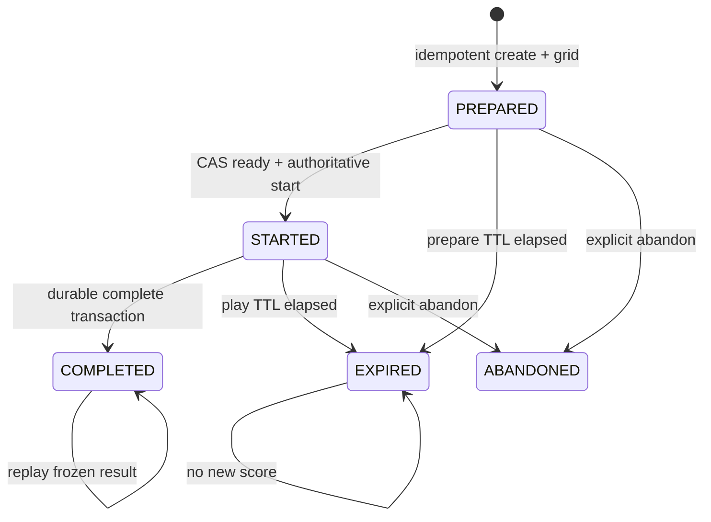

# FC-SYS-01 — playable sessions and permanent per-maze bests

RFC v0.1; proposed, not an activation or migration approval. Primary: server issue #5. Owners: Server Engineering; review: Integrator, Gameplay, security and independent QA. OD-05/12/15 govern timing, permanent fastest boards and assisted separation; OD-09/21 constrain reward compatibility and accessibility. EG-01/02/03/05/09 remain gates. No application route, database, historical record or deployment changes are included.

## Audit and pinned baseline

Source audit, not a live-system audit:

| Repository / main SHA | Evidence | Observed behavior |
| --- | --- | --- |
| server `d82c272b47486161bf9f37508b69fe3240678655` | `routes/mazeRoutes.js` start/complete | Authenticated user/profile ownership, date validation; every start appends a UUID attempt before sending grid. No ready endpoint or create deduplication; start conflicts return409. No publication-date check beyond maze existence. |
| same | `services/completions.js` | Server receipt minus stored start, rounded seconds, blanket3-second floor. No path or goal proof. UUID-scoped immutable result replay; missing-ID legacy latest selector pinned only within one request. Eight OCC retries on User save. Optional expiry, no expiry assigned by start. |
| same | `models/User.js`, `docs/completion-reliability.md` | Embedded unbounded attempt arrays, mixed immutable result snapshots, User optimistic concurrency. Invalid/missing __v blocks writes. One User write atomically commits completion, reward, progress; replacing it with several collections loses atomicity unless explicitly restored. |
| same | `routes/leaderboardRoutes.js` | Public daily/weekly/alltime queries scan every User; latest progress time, not historical minimum. Summer2025 daily restriction; weekly sums and different completion counts are not equal-comparison race boards. Names/profile IDs currently exposed; v2 public identity/privacy needs review. |
| same | `routes/userRoutes.js` progress | Direct fabricated progress completion already rejected; completed progress can be read. |
| same | completion service reward branch | A distinct attempt can award another unowned item for the same date. Duplicate UUID protection is not date-level first-completion eligibility. OD-09 requires separate EG-03 resolution. Never infer live duplicated awards or alter old inventory. |
| client main `8664c4f2026e8ec4857b31f40e51e5a7e1ce3b97` | `src/pages/MazePage.js` loading/finish | Display uses performance.now after response state initialization, not a server ready ACK or confirmed art/layout readiness. Local storage Date.now is not server scoring input. Finish locks input, saves UUID in sessionStorage, posts profile/date/UUID with15s timeout, retries same intent. |
| same | `src/game/{inputController,inputCoordinator,movement}.js` | Single scheduler, canonical client transition;400ms first hold repeat/180ms repeat; manual fresh presses can move faster than held repeat. Stationary fire clear, terminal completion; no server movement stream. 48px trailing geometry, two-forward-step turn buffer/540ms nominal expiry. Renderer/input fallback is client-side. |

Client audited files match the merged main source (local pre-merge branch was not substituted for main). Server main matches local source. Current auth verifies JWT; it does not prove play. No live DB/catalog, deployment, credential or CI inspection was performed. Existing synthetic completion integration tests provide a future implementation baseline; this RFC's model does not run them or start mongod. `scripts/rewardSeeder.js` is outside scope and must not be run.

## Proposed scoring semantics and trust boundary

`playable-receipt-v2` measures trusted server start timestamp reserved in the successful STARTED transaction to the first durably accepted completion receipt. Client input remains locked until a successful start response/status recovery. The server, not client Date.now or performance.now, determines official elapsed milliseconds. Client monotonic display is an estimate, freezes at local finish, and is replaced by saved official elapsed on recovery. Label its possible difference; do not rescale movement to match it.

The ready transaction reserves startedAt immediately before its guarded write; successful commit makes that value authoritative. It is not a claim to measure the exact physical commit instant. Ready write/acknowledgement overhead is charged. Completion captures receivedAt once after authentication and state binding at the trusted application boundary, retaining it through retries of that transaction. The first committed result wins, even if another uncommitted request arrived earlier. A subsequent HTTP retry after no durable commit receives a new timestamp. Queueing before the trusted boundary is not reconstructible; clock/ingress placement must be fixed in the scoring-method version.

Use an explicitly trusted UTC clock service at the application boundary with health/drift monitoring and integer milliseconds persisted. Monotonic process clocks help local deadlines but cannot alone compare separate processes/restarts. Persist clock epoch/health/uncertainty and reject ranking (hold for review) on backward time, unhealthy epoch or excessive drift. Do not clamp negative time to a plausible score. Distributed deployment and clock-health implementation require an operational proof before release.

For a compliant client, elapsed approximately includes start-response downlink + local play + completion uplink + trusted-server processing delay. Ready-upload/grid loading occur before start. No RTT subtraction: clients can manufacture delay and asymmetry makes half-RTT unjustified. Lost start ACK costs real server time; status recovery does not restart the clock. Lost completion before durable acceptance costs retry delay. These tradeoffs must be visible and owner-approved. Never advertise network-neutral timing.

The maze is delivered before readiness and archives are replayable: users can inspect/precompute a solution before starting. A modified client can claim readiness, ignore locks, forge completion, omit ability use or synthesize a legal replay. Receipt timing is authoritative but solving is not. v2 standard means policy-eligible client-claimed completion, not cheat-proof or server-verified traversal. Do not activate a stronger public integrity claim without server-authoritative movement or another separately reviewed protocol.

## Versioned API contract

New routes under `/api/v2`; v1 remains behaviorally unchanged and writes only its legacy era. All writes require JWT and resolve ownership from server data, including replay/status. Attempt IDs/nonces are not credentials. Bounds: small JSON payloads, UUID syntax, exact enums, rate limits by account/profile/IP, bounded open sessions; no caller-supplied clocks, score, owner, ranked validity or arbitrary class trusted. Unknown fields fail400 in v2. Cache private responses `no-store`.

Common session response:

```json
{"protocol":"session-v2","attemptId":"server-uuid","state":"PREPARED","revision":1,"mazeId":"stable-id","gridHash":"sha256","rulesVersion":"rules-v1","scoringMethod":"playable-receipt-v2","competitionVersion":"pending-fairness-policy","runClass":"standard","preparedExpiresAt":"UTC","serverNow":"UTC"}
```

| Operation | Request | Response / idempotency |
| --- | --- | --- |
| POST `/sessions` | `{subProfileId,date,createKey,requestedClass,abilityIds:[]}` |201 new PREPARED plus immutable grid/manifest/ready nonce. Replay same actor+createKey+canonical payload returns200 same UUID/grid/expiry; changed payload409 IDEMPOTENCY_CONFLICT. Check published date/grid and owned abilities. One open session per profile proposed; different createKey409 ACTIVE_SESSION with owned session reference, never implicitly abandon. |
| POST `/sessions/:id/ready` | `{readyKey,nonce,gridHash,rulesVersion}`, `If-Match:revision` | Server CAS PREPARED→STARTED;200 includes startedAt/playExpiresAt and revision. Nonce bound to UUID/hash/user, unguessable, stored hashed; rotated only by new preparation. Exact ready replay returns original start even with old revision, never extends expiry. New payload after transition409. |
| GET `/sessions/:id` | Auth only |200 current owned state, manifest versions, serverNow, official start/expiries and saved result if any. Lost create response recovers by replay createKey; lost ready ACK recovers here or identical ready replay. Never issue a new start automatically. |
| POST `/sessions/:id/complete` | `{completionKey}`, `If-Match:revision` | STARTED only. Transaction claims first durable receipt, immutable resultId/snapshot, validation state and reward outcome/outbox.201 first,200 exact replay. Concurrent different keys for same UUID return same result rather than award twice. Client timing fields400. No completion before STARTED409 NOT_STARTED. |
| POST `/sessions/:id/abandon` | `{abandonKey}`, `If-Match:revision` | Idempotent terminal ABANDONED; no score. Race against complete/ready has one CAS winner. Cannot abandon/rewrite completed result. Explicit user choice required to release another tab's active slot. |
| GET `/results/:id` | Auth for private result | Frozen original receipt/duration/reward snapshot plus separately versioned current adjudication status. Result retry does not alter time or choose another reward. |
| GET `/leaderboards/:mazeId` | `{scoringMethod,competitionVersion,runClass,cursor,limit<=100}` | Only accepted results in exactly requested segment. Default explicit current segment; no silent legacy fallback. Stable opaque cursor tied to board revision, no emails/ages/account names. |

Errors:400 malformed;401 unauthenticated;404 unknown/foreign owned resource (consistent non-enumerating policy);409 revision/state/key conflict;410 expired unfinished session;422 completion ineligible with reason;429 rate limit + Retry-After;503 transient/unknown commit with `retrySameOperation:true`. Result replay precedes unfinished expiry/version checks **after authorization**. If operation committed but response lost, retry same identifiers. If nothing committed, retry may receive a later timestamp. Client preserves create/ready/complete keys before network sends, isolates recovery by authenticated profile/date, and clears only after acknowledgement or explicit abandon.

### Client readiness and interruptions

PREPARED is delivered with maze manifest; initialize canonical state, selected renderer or working fallback, assets/layout, controls/focus and recovery handling before sending ready. Rendering errors before ready allow fallback; do not send ready from mount or merely HTTP success. Input and official timer remain locked pending ready/status ACK. A frame boundary can check readiness; no universal physical presentation proof exists. Client receipt of ACK unlocks once; duplicate ACK cannot create another scheduler or reset input. Completion sets a synchronous terminal latch and persists intent before POST. Browser reload during STARTED cannot reconstruct local path from this protocol: propose explicit unranked restart/abandon, not restoring an arbitrary caller position. A transient connection loss without state loss continues with clock running; return/status/retry allowed until server expiry. No automatic pause/refund for blur, tab throttling, modal or network loss. Local input cancellation remains unchanged.



Validation is orthogonal to session completion: `pending → accepted | quarantined | rejected`; append adjudication revisions for later review. Saved completed receipts always remain recoverable, including after TTL. Proposed prepare TTL5min, play TTL2h, one active slot per profile and24h create-key retention are tuning proposals, not approved behavior. After the create-key retention window, require a server-issued creation-window token and reject old-window keys rather than treating an old retry as a fresh create. Store sufficient tombstones to enforce that rule; precise key retention is a release gate. Retain completed snapshots for lifetime of result; no TTL deleting them. Cleanup expires unfinished sessions with CAS, releases active slot and leaves audit tombstone. On every write enforce server expiry even if cleanup has not run. Expired unfinished retries cannot revive a session. Pending validations do not occupy a playable slot.

## Security, latency and fairness assumptions

| Threat / failure | Enforcement | Limit / acceptance evidence |
| --- | --- | --- |
| Forged local clock, elapsed or position | No elapsed/position accepted in scoring API; server-owned receipt/start | Does not prove traversal; model clock-forgery fixture |
| Early ready / delayed ACK / precomputed archive | Input lock on honest client, immutable server start, bounded expiry | Malicious client can ignore lock/solve early. Owner must accept qualified integrity or require authoritative movement |
| Slow/asymmetric links, dropped complete | No RTT deduction; persist canonical first committed receipt | Unavoidable latency penalties, including retry-before-commit; model exposes them |
| Cross-profile/replayed token/UUID | Auth ownership every operation; request hash keys, bounded nonce lifetime | TLS/JWT security and rate limits still required; no credentials logged |
| Parallel starts/tabs | Unique active-slot transaction, explicit409 conflict | One-active policy needs owner/accessibility approval; unrelated device cannot reset clock |
| Duplicate / simultaneous completion | UUID unique result + transaction, reward eligibility unique by date | Real replica-set failure tests needed; in-memory model is not Mongo isolation proof |
| Fabricated fast or legal-looking run | Validation/quarantine, anomaly limits, versioned audit | Three-second blanket floor is not a valid maze-specific proof. Manual presses can beat400/180 hold cadence; never use repeat cadence as universal minimum |
| Replay submission extension | Optional bounded command log, validate canonical fire and goal on immutable grid | Legal replay can be generated offline; client timestamps/held durations forgeable. Added logs must not be marketed as authoritative time |
| Altered abilities / fog / viewport | Server grants ability manifest and class at create; immutable competition version | Client can hide use or read whole grid. Ranked viewport equality EG-09 is unresolved |
| Clock jumps / multi-node drift | Clock health/epoch and uncertainty; quarantine on anomalies | Requires monitored operational bounds; fail closed for ranking, retain receipt |
| Resource abuse / personal data | Rate caps, session limits, indexed queries, public alias policy, bounded retention | Values require security review; no raw device/IP evidence in public leaderboard |

Proposed `standard` uses no server-granted competitive ability; `assisted` is selected explicitly and durably when any such ability is granted, with an immutable sorted ability/config manifest. Cannot downgrade assisted to standard mid-session; upgrade requires abandon/restart or immediate irreversible assisted reclassification before further play, with protocol choice locked before implementation. Input modality, screen reader, reduced motion and normal accessibility controls are **not** automatically assistance. Renderer/camera information policy must be approved as competitionVersion (EG-09), not silently treated as an ability or inferred from client flags. Unknown legacy ability provenance stays unknown, not standard.

Validation: structurally valid receipts are pending until a versioned validator accepts or quarantines them. Hard invalid state/auth/hash failures cannot rank. Extremely fast, clock-anomalous or replay-inconsistent results are quarantined with appeal/review reason, not silently deleted. Bounds use grid/rule-specific action feasibility only after Gameplay proves them; no universal400/180 speed floor, and solver resource exhaustion means unknown, not cheating. Do not copy the current3-second rejection into v2 unquestioned. Rewards and completion credit must have explicit policy for quarantine/rejection before shipping; ranking quarantine alone must not issue duplicate rewards on retry. Legitimate replay/catch-up can improve personal best in its own segment, but never another date-level collectible opportunity (EG-03).

## Additive persistence and concurrency

Proposed new collections (not executed):

* `SessionsV2`: UUID PK, owning user/profile, immutable maze/date/gridHash/rules/scoring/competition/class/ability manifest; state/revision; createKey/requestHash; hashed ready nonce; start/expiry/clock health; terminal resultId. Unique `(userId,createKey)`; active slots in separate `ActiveSession(profileId unique,attemptId)` to avoid fragile partial-TTL uniqueness. Do not move embedded v1 data.
* `ResultsV2`: resultId PK, unique attemptId, owner/profile/maze/date/segment, integer elapsedMs, accepted receipt/start, immutable response/reward snapshot, clock evidence. `Adjudications(resultId,revision unique)` append decisions; latest decision is a projection, never mutate original result. Separate frozen completion snapshot from mutable eligibility.
* `BestV2`: unique `(profileId,mazeId,scoringMethod,competitionVersion,runClass)`, resultId, elapsedMs, acceptedAt, projectionVersion. Query index `(mazeId,scoringMethod,competitionVersion,runClass,elapsedMs,acceptedAt,resultId)`. Tie order elapsedMs, then acceptedAt, then resultId; equal time retains deterministic earliest accepted result. Same elapsed display can represent ties; cursor includes full sort tuple + board revision, restart pagination on revision change.
* `Outbox`: unique event ID, durable sequence, result/adjudication revision, processing status. Result, session terminal state, active-slot release, reward eligibility claim and outbox event commit in **one transaction** with retry on write conflict and unknown-commit recovery by stable IDs. Commit outcome unknown is not permission to assign another receipt/reward. Replica-set capability is a rollout prerequisite; current single-User OCC is not equivalent to a cross-collection transaction.
* Reward eligibility bridge: unique `(profileId,date)` shared across **all** v1/v2 writers, preserving prior attribution/unknown legacy status. Requires separately approved EG-03 reconciliation and compatibility writer cutover. Old v1 writers that still award per attempt must be upgraded or drained before claiming date-level exactly-once eligibility. No guessed backfill of rewards; mark uncertainty and block new eligibility pending approved policy.

Best projection worker consumes only accepted results, recomputes min with deterministic ties for a segment, and handles concurrent improvements by transaction/CAS on projection revision. Deduplicate event IDs. Public reads expose boardRevision/asOf and potential projection lag. An invalidation of a winning result triggers recomputation from remaining eligible results; `$min` alone cannot undo a disqualified best. Reordered adjudication events cannot resurrect an invalid score: compare revisions and read current decisions. Results remain authoritative; projection can be rebuilt in a shadow collection and swapped after comparison. Financial-style strong global rank snapshots are not promised by cursor pagination across concurrent updates.

## Legacy compatibility and safe migration gates

1. Inventory current schemas/indexes/backups and versionless User prevalence only in a separately authorized read-only environment. No inference from repository files about live contents. Capture old endpoints' output and inventory checksums under controlled authorization.
2. Mark legacy provenance in a **separate sidecar/view**, never overwrite embedded attempts/progress/time. Source-backed labels: `legacy-start-receipt-v1` for known server-generated starts; older unknown methods `legacy-unknown`, with source record IDs/hash. Missing attempt/result cannot be reconstructed from latest progress. Historical progress is not a personal-best archive; label it latest-record legacy, not fastest-ever.
3. Keep legacy boards/read endpoints and season/totals compatibility unchanged. New permanent per-maze boards require explicit segment and published maze membership, including archive dates. Do not merge seconds strings and v2 integer milliseconds without explicit parsing/unit provenance. Never manufacture historical v2 timestamps or assisted classifications.
4. Add collections/indexes in shadow mode after owner/DB approval and backup/restore rehearsal. Validate duplicates and index build cost offline/staging first; no automatic destructive reconciliation. Dual-read comparison only, no live v2 rank activation. Existing v1 users continue legacy scoring; protocol negotiation advertises supported versions, no silent v2 fallback after ready/complete uncertainty.
5. Resolve transaction infrastructure, reward writer coexistence, clock monitoring, class/version policy and independent QA. Then ship v2 server capability behind OFF flag, compatible client readiness lock/recovery behind separate OFF flag, staged synthetic/canary approval and human activation. This RFC does not authorize those steps.
6. Rollback disables new v2 creation and board visibility, but **retains** v2 status/complete/replay handling for in-flight sessions until drain/expiry. Never route a started v2 UUID into v1 latest-attempt selection. Keep committed v2 receipts/outbox/reward ledger; do not reverse granted rewards or rewrite old records. Stop projection worker or swap to prior shadow version; additive indexes/collections stay until separate reviewed removal. Rehearse backup restore and mixed-client drain before rollout.

## Acceptance and implementation roadmap

Run `node docs/rfcs/fc-sys-01/model.test.mjs` (no packages, network, DB or production configuration). `node docs/rfcs/fc-sys-01/replay.mjs` prints synthetic delayed-ACK/retry and ranking state. The model represents serializable commits and integer server time, not HTTP transport, Mongo transactions, real clock health, auth cryptography or cheat detection.

| Scenario | Required outcome / implementation acceptance |
| --- | --- |
| Lost create/ready ACK | Same key recovers same UUID/start; no reset or duplicate active slot |
| Concurrent different starts | One slot winner, other409; create-key collision with changed body409 |
| Slow load vs slow ACK/uplink | Loading excluded; ACK/uplink delays remain charged; no client clock credit |
| Lost completion after commit | Same snapshot/receipt/award; no later time or rank rewrite |
| Completion never committed | Retry receipt is later; openly documented latency penalty |
| Concurrent duplicate completions | One immutable result and outbox effect; all callers recover winner |
| Distinct attempts, same date | Personal best may improve; only one date-level reward opportunity; old quantities untouched |
| Slower replay / assisted result | Standard personal best not overwritten; separate assisted board |
| Expire/abandon vs ready/complete | One terminal winner; saved result recoverable after TTL |
| Quarantine / reversed outbox | No ranked pending score; invalidated best falls back; no stale resurrection |
| Legacy / clock forgery | Separate legacy display; client clock never determines receipt; anomalous server clock held |
| Real storage/network follow-up | Replica-set failpoints before/after commit, unknown commit, process restart, auth ownership, uniqueness collisions, rate limits and projection repair; mandatory independent QA |

Phase A (this package): pinned audit, explicit protocol/policy proposal and executable fixtures; issue review before any implementation PR. Phase B: integrator-approved API/schema RFC promotion, owner decisions below, Gameplay feasibility policy and independent QA acceptance matrix. Phase C: separate substantive server implementation with isolated replica-set contract/security/concurrency tests, no live migration. Phase D: client readiness/ACK/restore integration with render fallback and exactly-once completion regression. Phase E: separately authorized legacy/reward reconciliation, staging migration/rollback rehearsal and shadow-board comparison. Phase F: owner/security/QA release approval; production activation remains a separate action.

Outstanding decisions (do not reopen approved permanent-fastest/standard-vs-assisted principles):

* Owner/Gameplay: acceptable qualified integrity with client-claimed movement, pre-start maze visibility and latency penalty; or investment in authoritative movement/challenge delivery. This gates public competitiveness claims.
* Owner/UX: readiness/ACK waiting copy, no-pause/disconnect/reload policy, one-active-session scope and expiry durations; long-accessibility sessions require evidence before TTL lock.
* Gameplay/Integrator: competitionVersion for logical view/fog fairness and renderer/camera differences; no client-only flag evidence treated as authority.
* Progression/owner: quarantine effect on credit/rewards and non-destructive handling of unknown historical date eligibility; EG-03 must precede coexistence of reward writers.
* Security/ops: clock uncertainty threshold, API quotas, nonce/key retention, appeal/audit retention, public alias/privacy policy and transaction infrastructure proof.
* Integrator/QA: assign reviewers, pin implementation target SHAs and require independent failure/clock/rollback evidence; issue remains design/review, not Ready-to-activate.


### Model validation record and limits

Node 24.19.0 direct execution of `model.test.mjs`: **20 passed, 0 failed, 0 skipped**. Replay output is retained in `replay-output.json`. The model deliberately imports no application, database, environment credentials or third-party dependencies. A single profile subject stands in for authenticated user/profile resolution; actor strings are fixtures, not production identity validation. Simultaneous operations are tested as serialized JS commits in both start-race orderings, not as proof of distributed concurrency.

The model omits HTTP status/envelope validation, canonical request hashing, If-Match plumbing, nonce cryptography, quotas, real clock health and cross-collection commit failures; those remain mandatory implementation acceptance tests. Its eligibility reservation is an illustrative first-completion claim with reward held, not an inventory grant or a decision on quarantined reward policy. Its in-memory full recomputation demonstrates projection repair semantics, not the indexed production query or throughput. The legacy sentinel fixture proves only that this model does not rewrite supplied historical data; a real migration needs separate preservation tests. No production guarantee is inferred from these 20 fixtures.

Integrator handoff: review API/client boundary, writer coexistence, rollout/drain and target SHAs before opening an implementation PR. Independent QA handoff: challenge lost-ACK latency, expiry races, actual replica-set unknown commits, adjudication ordering, historical unknowns and counterexamples to integrity claims; provide independent pinned-SHA evidence. Gameplay/security review must settle feasibility/classification assumptions. No implementation phase or release gate is marked complete by the author.
